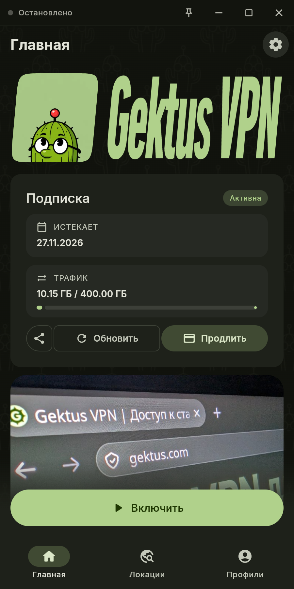

  

# GektusClashX

**Русский** · [English](README_EN.md)

Многоплатформенный прокси-клиент на базе FlClash и ClashMeta с открытым исходным кодом и без рекламы. Поддерживает подписки и позволяет провайдеру настраивать оформление и поведение приложения.

**Платформы:** Android, Android TV, Windows, Linux и macOS.

## Скачать

<a href="https://apps.obtainium.imranr.dev/redirect?r=obtainium://app/%7B%22id%22%3A%22com.gektus.clashx%22%2C%22url%22%3A%22https%3A%2F%2Fgithub.com%2Fgektusvpn%2FGektusClashX%22%2C%22author%22%3A%22gektusvpn%22%2C%22name%22%3A%22GektusClashX%22%2C%22preferredApkIndex%22%3A0%2C%22additionalSettings%22%3A%22%7B%5C%22includePrereleases%5C%22%3Afalse%2C%5C%22fallbackToOlderReleases%5C%22%3Afalse%2C%5C%22filterReleaseTitlesByRegEx%5C%22%3A%5C%22%5C%22%2C%5C%22filterReleaseNotesByRegEx%5C%22%3A%5C%22%5C%22%2C%5C%22verifyLatestTag%5C%22%3Atrue%2C%5C%22sortMethodChoice%5C%22%3A%5C%22date%5C%22%2C%5C%22useLatestAssetDateAsReleaseDate%5C%22%3Afalse%2C%5C%22releaseTitleAsVersion%5C%22%3Afalse%2C%5C%22trackOnly%5C%22%3Afalse%2C%5C%22versionExtractionRegEx%5C%22%3A%5C%22%5C%22%2C%5C%22matchGroupToUse%5C%22%3A%5C%22%5C%22%2C%5C%22versionDetection%5C%22%3Atrue%2C%5C%22releaseDateAsVersion%5C%22%3Afalse%2C%5C%22useVersionCodeAsOSVersion%5C%22%3Afalse%2C%5C%22apkFilterRegEx%5C%22%3A%5C%22%5C%22%2C%5C%22invertAPKFilter%5C%22%3Afalse%2C%5C%22autoApkFilterByArch%5C%22%3Atrue%2C%5C%22appName%5C%22%3A%5C%22%5C%22%2C%5C%22appAuthor%5C%22%3A%5C%22%5C%22%2C%5C%22shizukuPretendToBeGooglePlay%5C%22%3Afalse%2C%5C%22allowInsecure%5C%22%3Afalse%2C%5C%22exemptFromBackgroundUpdates%5C%22%3Afalse%2C%5C%22skipUpdateNotifications%5C%22%3Afalse%2C%5C%22about%5C%22%3A%5C%22%5C%22%2C%5C%22refreshBeforeDownload%5C%22%3Afalse%2C%5C%22includeZips%5C%22%3Afalse%2C%5C%22zippedApkFilterRegEx%5C%22%3A%5C%22%5C%22%2C%5C%22includeTarballs%5C%22%3Afalse%2C%5C%22tarballedApkFilterRegEx%5C%22%3A%5C%22%5C%22%7D%22%2C%22overrideSource%22%3Anull%7D"></a>

Выберите сборку для своей системы и архитектуры. Для Linux доступны AppImage, DEB и RPM; [зависимости для Debian/Ubuntu](docs/configuration.md#linux) описаны в документации.

  

Пример оформления приложения для GektusVPN.

## Возможности

- **Подписки:** срок действия, расход трафика, обновление и продление из приложения.
- **Оформление провайдера:** логотип, фон, цвета, анонсы, новости и контакты поддержки.
- **Импорт профилей:** по ссылке, из файла или через QR-код; передача подписки с телефона на Android TV.
- **Android TV:** отдельные экраны и навигация с пульта. **macOS:** управление из строки состояния.
- **Настройки и обновления:** параметры от провайдера с возможностью локального переопределения, проверка и загрузка обновлений приложения.

## Документация

- [Настройка клиента и подписок](docs/configuration.md) — HTTP-заголовки, YAML-параметры, переопределение настроек, Linux и Android actions.
- [История изменений](CHANGELOG.md).
- [Лицензия GPL-3.0](LICENSE).
