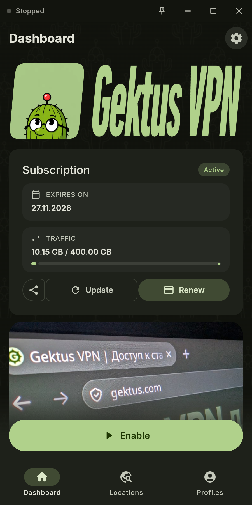

  

# GektusClashX

[Русский](README.md) · **English**

An open-source, ad-free proxy client based on FlClash and ClashMeta. It supports subscriptions and lets providers customize the app’s appearance and behavior.

**Platforms:** Android, Android TV, Windows, Linux, and macOS.

## Download

<a href="https://apps.obtainium.imranr.dev/redirect?r=obtainium://app/%7B%22id%22%3A%22com.gektus.clashx%22%2C%22url%22%3A%22https%3A%2F%2Fgithub.com%2Fgektusvpn%2FGektusClashX%22%2C%22author%22%3A%22gektusvpn%22%2C%22name%22%3A%22GektusClashX%22%2C%22preferredApkIndex%22%3A0%2C%22additionalSettings%22%3A%22%7B%5C%22includePrereleases%5C%22%3Afalse%2C%5C%22fallbackToOlderReleases%5C%22%3Afalse%2C%5C%22filterReleaseTitlesByRegEx%5C%22%3A%5C%22%5C%22%2C%5C%22filterReleaseNotesByRegEx%5C%22%3A%5C%22%5C%22%2C%5C%22verifyLatestTag%5C%22%3Atrue%2C%5C%22sortMethodChoice%5C%22%3A%5C%22date%5C%22%2C%5C%22useLatestAssetDateAsReleaseDate%5C%22%3Afalse%2C%5C%22releaseTitleAsVersion%5C%22%3Afalse%2C%5C%22trackOnly%5C%22%3Afalse%2C%5C%22versionExtractionRegEx%5C%22%3A%5C%22%5C%22%2C%5C%22matchGroupToUse%5C%22%3A%5C%22%5C%22%2C%5C%22versionDetection%5C%22%3Atrue%2C%5C%22releaseDateAsVersion%5C%22%3Afalse%2C%5C%22useVersionCodeAsOSVersion%5C%22%3Afalse%2C%5C%22apkFilterRegEx%5C%22%3A%5C%22%5C%22%2C%5C%22invertAPKFilter%5C%22%3Afalse%2C%5C%22autoApkFilterByArch%5C%22%3Atrue%2C%5C%22appName%5C%22%3A%5C%22%5C%22%2C%5C%22appAuthor%5C%22%3A%5C%22%5C%22%2C%5C%22shizukuPretendToBeGooglePlay%5C%22%3Afalse%2C%5C%22allowInsecure%5C%22%3Afalse%2C%5C%22exemptFromBackgroundUpdates%5C%22%3Afalse%2C%5C%22skipUpdateNotifications%5C%22%3Afalse%2C%5C%22about%5C%22%3A%5C%22%5C%22%2C%5C%22refreshBeforeDownload%5C%22%3Afalse%2C%5C%22includeZips%5C%22%3Afalse%2C%5C%22zippedApkFilterRegEx%5C%22%3A%5C%22%5C%22%2C%5C%22includeTarballs%5C%22%3Afalse%2C%5C%22tarballedApkFilterRegEx%5C%22%3A%5C%22%5C%22%7D%22%2C%22overrideSource%22%3Anull%7D"></a>

Choose the build for your operating system and CPU architecture. Linux packages include AppImage, DEB, and RPM; see the [Debian/Ubuntu dependencies](docs/configuration_EN.md#linux).

  

Example of GektusVPN provider branding.

## Features

- **Subscriptions:** view expiration dates and traffic usage, update and renew subscriptions from the app.
- **Provider branding:** custom logos, backgrounds, colors, announcements, news, and support contacts.
- **Profile import:** add a URL, file, or QR code; transfer a subscription from your phone to Android TV.
- **Android TV:** dedicated screens and remote navigation. **macOS:** control the app from the menu bar.
- **Settings and updates:** provider settings with local overrides, plus app update checks and downloads.

## Documentation

- [Client and subscription configuration](docs/configuration_EN.md) — HTTP headers, YAML parameters, settings overrides, Linux, and Android actions.
- [Changelog](CHANGELOG.md).
- [GPL-3.0 license](LICENSE).
